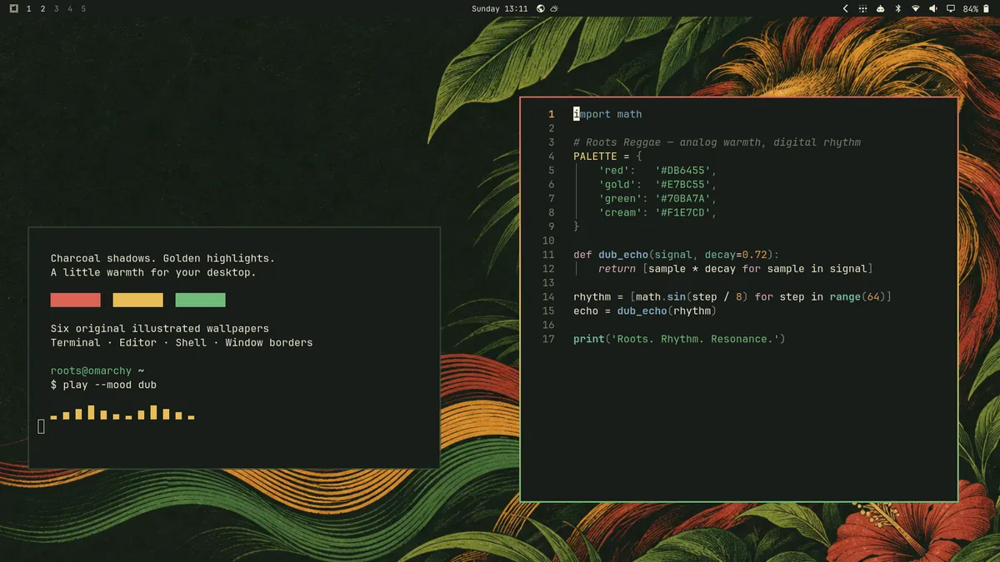

# Roots Reggae

A dark Omarchy theme inspired by reggae and dub: charcoal-green surfaces,
warm cream text, honey-gold highlights, and red–gold–green window borders.



## Install

```bash
omarchy theme install https://github.com/42lizard/omarchy-roots-reggae-theme.git
```

Activate an installed copy with `omarchy theme set roots-reggae`.
Cycle wallpapers with `omarchy theme bg next`.
Requires an Omarchy version supporting theme generation from `colors.toml`.
Application configurations are generated by Omarchy; this repository ships no executable theme configuration.

## Wallpapers

Six original AI-generated illustrations, all 1672 × 941 pixels:

- **Blue Mountains Dusk** — misty mountain ridges and a golden sunset.
- **Dub Moonlight** — a vintage sound system on a moonlit shoreline.
- **Vinyl Roots** — flowing red, gold and green vinyl grooves.
- **Kingston Rain** — a quiet Caribbean street after tropical rain.
- **Lion of Roots** — an engraved lion with flowing reggae colors.
- **Dub Observatory** — a warm analog recording studio beneath the stars.

The wallpapers were generated using OpenAI's built-in image generation tool,
with art direction and selection by the theme author. Prompts are included in
`artwork-prompts-1.json` and `artwork-prompts-2.json`.
No photographs are included. The preview is a real Omarchy desktop capture.

## License

Theme configuration and documentation: [MIT](LICENSE).
AI-generated wallpaper assets and the desktop preview are made available under
the same terms to the extent the author holds applicable rights.
